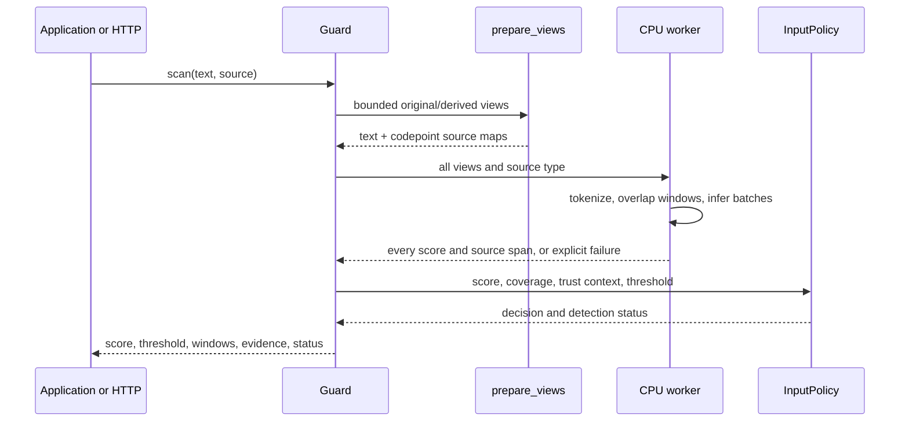
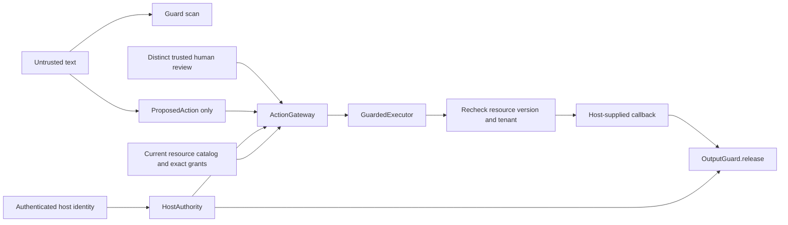

# kjnlae codebase

This guide describes the **current experimental 0.3 toolkit**. The runtime is a Python SDK, a small optional HTTP adapter, and a one-page React scanner. Development-only model training, fixture benchmarks, and synthetic scenarios are separate from the everyday CLI. The older v0.1 HTTP contracts and rule-based injection detector are absent.

## What is public

| Surface | Entry point | Responsibility |
|---|---|---|
| Python scanner | `from kjnlae import Guard` | Verify and run the local fine-tuned model; return an inspection and input-policy decision. |
| Host action controls | `from kjnlae import ActionGateway, HostAuthority, ResourceGrant, ResourceCatalog, GuardedExecutor` | Check exact principal/tenant/resource/tool/destination/approval at a trusted application boundary. |
| Host output controls | `OutputGuard.inspect` and `OutputGuard.release` | Check known secrets, links, structured fields, recipient, and source grants before host release. |
| User CLI | `kjnlae model download\|verify`, `doctor`, `scan`, `serve` | Install, diagnose, inspect, and start the dashboard. |
| Maintainer CLI | `python -m kjnlae.maintainer_cli` | Reproduce training, benchmarks, and scripted sandbox cases. |
| HTTP | `kjnlae.api.app.create_app` | Bounded authenticated transport; no automatic tool execution. |
| Dashboard | `frontend/src/App.tsx` | Call real HTTP scan/capabilities endpoints and render measured windows. |

The SDK is independent of FastAPI and React. Importing `kjnlae` does not download weights or import PyTorch. Creating a `Guard` verifies a configured artifact; the first scan starts a local CPU worker. `with Guard() as guard:` closes that worker when finished. Explicit `model_dir`/`model_hash` arguments override environment configuration; otherwise the per-user reviewed-model directory is detected. A partial explicit override is an error/incomplete configuration rather than an unpinned load.

## End-to-end scan path

`schemas_v2.py` defines strict request/result contracts. Scan requests contain descriptive source metadata, **not** principal, grants, approval, or policy. Text is limited to 32,768 Python Unicode codepoints; HTTP bodies are limited to 128 KiB. `detection/preprocessing.py` creates an original view and bounded NFKC/format-character, HTML-entity, and selected Base64 views. Each transformed character maps back to a span of the original input. Its regular expressions find encodings/entities; they **never classify injection**. The original text remains available for the host; preprocessing does not execute decoded text. Too many derived views/candidates mark inspection incomplete.

`classifiers/local.py` uses a spawned worker, CPU-only PyTorch/Transformers, bounded token length, overlapping token windows, batches, a maximum window count, and a deadline. Source type is added as text prefix to each window because the model was trained with that input format. A window's source span comes from tokenizer offsets through the preprocessing source map; it may cover a larger area for decoded text. The worker returns the maximum injection-class softmax score and **all** window scores. If token coverage exceeds the budget, the worker errors and `Guard` reports `INCOMPLETE`. The Linux worker additionally uses `RLIMIT_AS`; macOS/Windows skip that POSIX-specific control while keeping timeout, token/window, and input bounds. The worker loads only local safetensors with `trust_remote_code=False` and `local_files_only=True`.

`classifiers/artifacts.py` pins the public repository, exact commit, and reviewed manifest SHA-256. `download_public_model` stages an explicit network download in the destination's parent, verifies the manifest and every required file, then renames it into place; an existing destination is refused. `verify_artifact` checks the base revision, trained/evaluated metadata, experimental quality status, file digests, expected labels, and absence of pickle weight files. The public weights are separate from Git. The reviewed model's manifest SHA-256 is `54e6df56616f4533e1c6a9624f3372ad14bc4d85f5ae97b45c1b3b515a83de9b`.

`policies/decision.py` translates a **complete** score and manifest threshold into `ALLOW`, `WARN`, `BLOCK`, or `REQUIRE_REVIEW` based on source and trusted analysis context. It contains no lexical prompt-injection signatures. Missing, corrupt, unavailable, timed-out, or partial inference is `INCOMPLETE` and cannot return an `ALLOW` scan. The score is uncalibrated; a threshold crossing is model evidence, not proof of attack success. `Guard.inspect` returns `windows` for all scored windows and `evidence` for windows at/above threshold, along with source offsets and the model hash. The dashboard uses exactly these fields; it does not infer word-level causes.

## Independent permissions

`guards/resources.py` defines immutable `ProposedAction`, `HostAuthority`, `ResourceRecord`, and `ResourceGrant`; `ResourceCatalog` is the local synthetic/reference catalog. Hosts must derive identity and grants from authenticated application state. `guards/actions.py` checks principal and tenant; allowed tool; same-tenant current resource; exact operation/version/expiry grant; destination and parameter restrictions; required-control readiness; and a distinct reviewer's one-use, time-limited approval for side effects. Approval binds the action digest, principal, tenant, and resource version. HTTP never accepts approval tokens. `guards/executor.py` consumes authorization only when actually executing a host callback, rechecks the resource under the catalog lock, and reports an uncertain outcome if a callback raises after a possible side effect. Real databases need equivalent transactional rechecks.

`guards/output.py` performs **output controls, not prompt-injection classification**. It checks configured known values (including bounded transformed forms), external links against an allowlist, and structured fields. `release` additionally checks host-owned recipient and current resource grants. It cannot discover arbitrary secrets. `context.py` carries trusted context separately from scanned content. `integrations/rag.py` enforces tenant/resource ACLs before scanning retrieved chunks and withholds blocked/incomplete content. `integrations/hosts.py` and `api/chatbot.py` provide fictional hospital/enterprise reference workflows and are not mounted on the main scanner app. The examples show how to use them; no live LLM or privileged external tool is connected.

## HTTP and dashboard

`api/config.py` loads deployment-owned settings and an optional bounded authority file; production requires a long API key and pinned artifact. `api/app.py` registers health, capabilities, scan, RAG inspection, action preview, and output inspection routes. `api/middleware.py` limits body size and peer request rate, and sets secure response headers; `api/audit.py` logs allowlisted metadata without prompt bodies. Readiness requires the model worker to be available. The API's action route only previews server-owned authorization; its output route only inspects content and sets `release_authorized:false`. There is no API route that grants identity, creates approval, executes a tool, releases a resource, stores prompt history, or runs a benchmark.

`frontend/src/App.tsx` fetches `/v2/system/capabilities` and posts `/v2/scan`. It keeps text and optional API credential in React component state only. `WindowScores.tsx` draws actual score bars, threshold relation, source view, character span, and a source excerpt for each scored window; the highest score is labeled. `Evidence.tsx` slices Unicode codepoints with `Array.from` and renders React text/`<mark>` elements, so submitted HTML is escaped. Selecting a window highlights its mapped source span; the default highlights above-threshold spans. It deliberately gives no token attribution or fabricated explanation. CSS is responsive with zero border radius. The built UI is served by FastAPI when `frontend/dist` exists; Vite's dev server proxies API calls during frontend work.

## Reproducibility and repository map

| Directory/file | Purpose |
|---|---|
| `src/kjnlae/guard.py`, `schemas*.py`, `policies/`, `detection/`, `classifiers/` | SDK, contracts, preprocessing, model verification and inference. |
| `src/kjnlae/guards/`, `context.py`, `integrations/` | Independent host-owned action/output boundaries and RAG/example integrations. |
| `src/kjnlae/api/`, `cli.py` | Optional HTTP adapter and small user CLI. |
| `src/kjnlae/training/`, `evaluation/`, `maintainer_cli.py` | Genuine CPU training, prepared splits, optional public dataset adapters, measured benchmark and scripted sandbox. Not imported by the normal SDK/CLI path. |
| `datasets/fixtures/`, `docs/reports/`, `docs/model-*.md` | Original regression examples, frozen measurements, provenance, and training instructions. |
| `tests/`, `scripts/verify_all.sh`, `.github/workflows/ci.yml` | Unit/integration/security tests and release gates. Real-weight tests require an installed artifact; CI without weights reports that limitation. |
| `frontend/`, `Dockerfile`, `compose.yaml` | React/Vite scanner and optional local container runtime. |

The public model is experimental English DistilBERT. Training used separate TRAIN, VALIDATION, CALIBRATION, and held-out test partitions, with an additional frozen authored fixture. Its best selected checkpoint and limitations are detailed in [follow-up evaluation](docs/reports/v0.2-followup-evaluation.md). The current runtime does **not** train, automatically download, call a hosted LLM, or rely on the scanner for tool permission. Read [README.md](README.md) for platform installation and [docs/verification.md](docs/verification.md) for executed checks.
