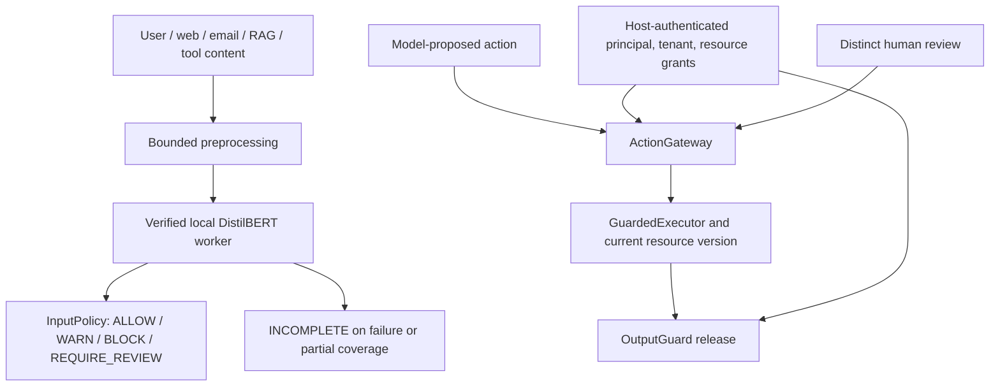

# Architecture

`Guard` is a reusable Python library and owns no tool execution. It keeps original input, creates bounded normalized/decoded views with source maps, and sends **all** supported views and token windows to a separate timed CPU worker using a verified local safetensors artifact. Input policy translates complete model evidence into a decision. It never imports the removed v0.1 rule detector. A model score is not a calibrated probability. A `NO_EVIDENCE_FOUND` result does not authorize a tool.

`ActionGateway` and `GuardedExecutor` are independent of injection classification. Trusted host code creates principals, tenants, exact resource grants, tool lists, destination allowlists and human approvals. Request or model text can only propose an action; it cannot mint authority. The executor rejects non-ALLOW decisions and rechecks catalog version/owner/tenant before a synthetic callback. External persistent systems need their own transactionally equivalent recheck.

`RagGateway` checks host catalog and grants before scanning or passing chunks to generation. Fictional hospital and enterprise integrations demonstrate record-level and tenant boundaries. `OutputGuard` checks known sensitive values, links, recipients, fields and resource grants before release. These layers remain required when the model misses an attack. The default missing-model behavior withholds sensitive actions and reports scan `INCOMPLETE`.

FastAPI supplies bounded HTTP, auth, CORS, rate limits, readiness and metadata-only SQLite history. React consumes the actual `/v2` API and renders untrusted strings as text. The package, server, UI and training code have separate dependency directions: core guards do not import FastAPI or React, and no request text is executed as shell/code.
