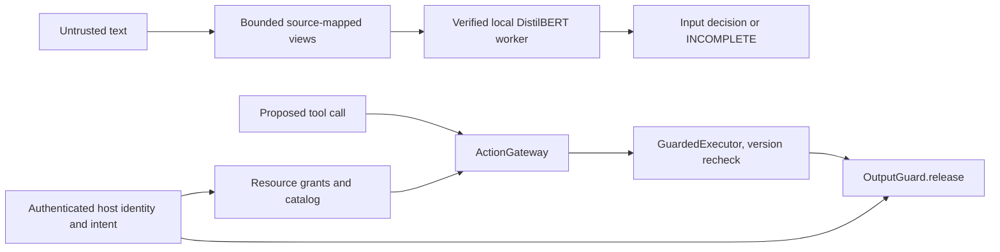

# Architecture

`Guard` is the reusable scanner and has no authority to execute tools. It creates bounded original/derived views, passes them to a spawned CPU worker, and applies `InputPolicy` to complete model evidence. It returns the actual maximum model score, threshold, all scored windows, mapped source spans, and an explicit incomplete status on failure. No lexical prompt-injection classifier runs. The local artifact is verified before inference, and the worker cannot run model-supplied code or use network weights.

`ActionGateway` and `GuardedExecutor` are independent of injection classification. Only trusted application code may create a principal, tenant, exact grants, allowed tools/destinations, and human approvals. A prompt or proposed action can request an operation but cannot create permission. The executor rechecks resource version, owner, and tenant before invoking a host callback. External stores require their own transactional equivalent.

`RagGateway` checks tenant/catalog/grants before scanning retrieved content; it withholds blocked or incomplete chunks. Fictional hospital and enterprise hosts demonstrate resource boundaries and output release. `OutputGuard` checks known sensitive values, links, structured fields, recipient, and resource grants. Its deterministic checks are output/data controls, **not** prompt-injection classification.

FastAPI provides bounded authenticated transport, readiness, safe errors, rate limits, CORS, and metadata-only audit logging. The one-page React dashboard displays actual scan results. Core scanning and guards do not import FastAPI, React, training modules, or a hosted LLM. See [CODEBASE.md](../CODEBASE.md) for detailed call sequences and ownership.
