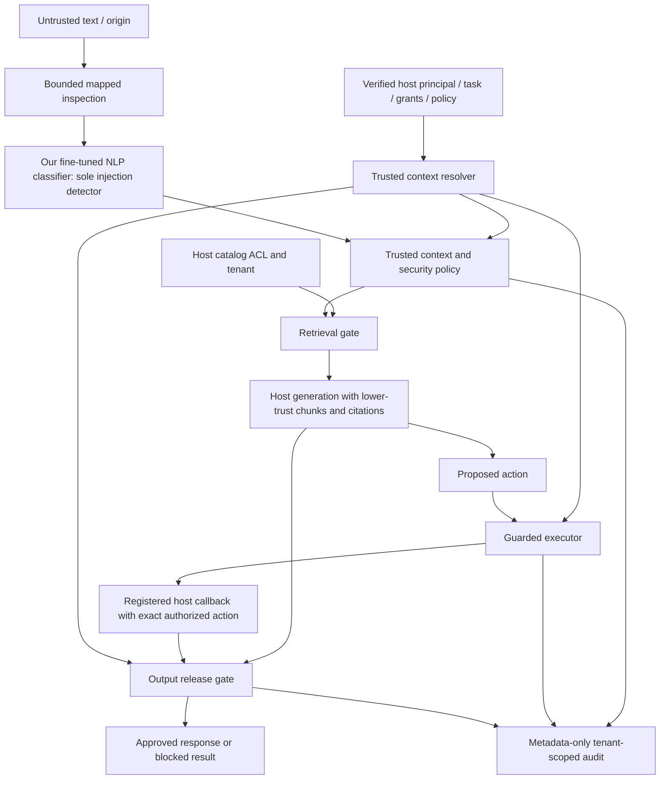

# kjnlae v0.2 proposed architecture specification

Status: **PROPOSED — awaiting user approval; implementation not authorized yet.**
Date: 13 October 2026. Baseline: `be80f10ff3c9cee0b7db1cfb22dcb911cccfea9f`.
Revision: model-only prompt-injection detection, superseding the prior hybrid
design; genuine English-first DistilBERT fine-tuning on the free CPU environment.
No training has run. The revised specification and feasibility experiment require
review before implementation; the English-first DistilBERT approach is retained.
Companion: [executed baseline assessment](2026-10-13-v0.2-baseline.md).
This specification addresses the uploaded MASTER DEVELOPMENT PROMPT v0.2.
The detailed implementation plan will be written only after specification approval.

## 1. Goal and success criteria

Provide an offline-first Python defense gateway that developers install at input,
retrieval, execution and response-release boundaries. Intended users are RAG,
healthcare, enterprise and agent application developers. Provide our genuinely fine-tuned
NLP classifier as the sole, default prompt-injection detector, real CPU fine-tuning,
independent security enforcement, local persistence,
FastAPI, React and the existing square minimal dashboard/custom logo.

Security success means the specified unauthorized operations cannot reach the
reference host executor or response recipient, even with a scanner bypass.
Detection quality, policy correctness and legitimate task utility are separately
measured. Patient/employee resource questions are not inherently prompt injection.
No universal detection, DLP, regulatory compliance or clinical safety claim follows.

Constraints: Python 3.12+, no mandatory GPU/network/paid APIs, no model weights in
Git, no remote model code, no new distributed infrastructure, no arbitrary plugins,
no caller-defined policies or executable scan content. Preserve working independent
authorization, output and privacy controls. Detection modes/contracts intentionally
change with explicit migration instructions. Retain historical regression reports;
replace obsolete executable rule-detector tests with model/preprocessing/migration
tests rather than retaining a runtime signature detector.

Our fine-tuned classifier is a mandatory release deliverable. Every application
scan requires our verified exported weights. Missing weights produce an explicit
incomplete/error result. Remove the rule engine and all detection-mode selection:
no keyword/regex/heuristic prompt-injection detector, ordinal rule severity, hybrid
pipeline, upstream-model fallback or mock fallback exists in the released application.
Training
uses only the current free CPU environment. Changing environment/model or using
paid compute requires user approval. Offline inference requires installed artifacts;
dependency/model/data acquisition is an explicit online preparation stage. Cloud
coding access does not establish sufficient uninterrupted time for a full training run.

## 2. Alternatives and recommendation

| Alternative | Advantages | Costs and boundary risks |
|---|---|---|
| **Evolve the core with typed contexts, policies and an execution wrapper (recommended)** | Reuses tested controls; small dependencies; works for any host; explicit grants and tenant checks; independently testable | Requires careful versioned contracts and host adapters; still cannot judge every semantic instruction |
| Framework-first LangChain/LlamaIndex orchestration | Familiar framework hooks and quick demos | Heavy/version-sensitive dependencies; framework messages alone do not establish permissions; excludes lean SDK users |
| Hosted LLM critic/agent judge for all scans | Can reason over tasks and paraphrases | Network dependence, data disclosure, cost/latency and a second injectable model; conflicts with offline-first defaults |

Choose the first. Optional framework adapters can be thin, separately tested
integrations; a framework is not a required security authority. An optional local
agent benchmark is isolated from the production core and clearly distinguished
from the sequence classifier. No hosted critic is required.

## 3. Threat model and authority ownership

Attackers may control messages, documents/chunks, HTML, email, tool results,
proposed actions, context claims and generated output. They may forge role labels,
approvals, recipients, citations and tenant IDs; obfuscate instructions; substitute
action parameters; replay tokens; exploit control failures or combine chunks.

Trusted components: host identity verification, approved resource catalog and ACLs,
task-intent resolver, deployed policy/model manifests, tool registry, reviewer
verification and guarded executor. A static service API key authenticates that
service only. It does not authenticate an arbitrary user identifier in a body.

The Python SDK accepts trusted context from host code because it shares that
process trust boundary. Dataclasses and Pydantic validation are not credentials.
REST receives content and opaque context/resource references; the server resolves
authority from verified service credentials and server-owned configuration/hooks.
It never constructs grants from content, agent text or request-body claims.
Unresolved principal, tenant, provenance, operation or resource fails authorization.

Healthcare access requires explicit tenant/patient grants, not a magic clinician
role. Enterprise access distinguishes directory/public information from restricted
HR/finance records. Injection is lower-trust instruction redirection; unauthorized
direct user requests are handled by independent permissions even without findings.

## 4. Module boundaries and data flow

Maintain `detection/`, `classifiers/`, `guards/`, `evaluation/`, `storage/`, API and CLI.
Add `context.py` and cohesive `policies/` and `integrations/` modules, rather than
moving HTTP or execution code into `Guard`. Schemas may become a package with
compatible non-detection exports retained. Delete `detection/rules.py` and its
imports/configuration/dispatch rather than leaving an inactive secondary detector.
`detection/` contains preprocessing/coverage orchestration only. Core depends on
types and policy interfaces only.
Host callbacks are explicitly registered application code, never imported from
request strings. No document is promoted into a system/developer message.

## 5. Contracts and compatibility

`ContentEnvelope`: bounded text, source kind, opaque source/chunk ID, claimed
origin metadata. Trusted provenance is attached separately by the host resolver.
Missing provenance is explicit; caller source/trust labels cannot upgrade authority.

`TrustedSecurityContext`: authenticated principal/tenant, application type, trusted
task, workflow/stage, operation categories, resource grants, destinations,
sensitivity, resolver-issued analysis/code purpose, policy/detector versions.
Host context and content claims have separate types and separate call arguments.
HTTP rejects principal/grant/approval-state fields rather than ignoring them.

`DocumentChunk`: document/chunk IDs, text, source provenance and attribution.
ACL, tenant and sensitivity are looked up in a host resource catalog; retrieved
metadata is a claim until resolved. ACLs cannot be supplied by retrieved content.

`InspectionResultV2` has:

- `detection_status`: NO_EVIDENCE_FOUND, SUSPICIOUS, MALICIOUS_INDICATORS, INCOMPLETE.
- `policy_decision`: ALLOW, WARN, BLOCK, REQUIRE_REVIEW, with reason codes.
- `evidence`: model-classified windows with view identity, mapped original
  character ranges, model-specific scores and artifact identity. A positive window
  is not exact token attribution or proof of malicious intent.
- `preprocessing_diagnostics`: transformations and coverage/budget issues, separate
  from injection evidence; no diagnostic severity or attack score.
- `risk_assessment`: model-derived assessment, uncertainty and independent policy
  reason codes; no keyword/regex/heuristic attack score or probability of success.
- `inspection_complete` and `coverage`: characters, supported views, tokens/windows,
  budget exhaustion, unsupported transformations and coverage scope.
- `model_status`: AVAILABLE, MISSING, UNAVAILABLE, CORRUPTED, TIMED_OUT, ERROR,
  COVERAGE_EXCEEDED; no successful disabled-detector scan;
  pinned model/revision/manifest hash and explicit optional score.
- `recommended_action`, policy ID/version/hash, detector version and latency.

Only the fine-tuned classifier supplies injection evidence/status. NO_EVIDENCE_FOUND
requires complete successful inference and grants no action or assurance of safety.
INCOMPLETE takes precedence when any supported view/window was not evaluated, while
retaining available partial model evidence. MALICIOUS_INDICATORS means the model
score meets the documented threshold, not proven compromise or attacker intent.

Authorization and execution are distinct result objects:
`AuthorizationResult` includes decision, opaque action digest, policy/version,
safe reason code and required approval; `ExecutionResult` includes NOT_ATTEMPTED,
DENIED, SUCCEEDED, FAILED or UNKNOWN plus inspected output. It never marks a tool
executed merely because an authorization decision is ALLOW.

Retain `Guard.scan` as a documented convenience alias to the new model-only result;
add `inspect`, `inspect_chunks`, `capabilities` and separate security helpers.
Remove the request `mode` field and mode enum entirely from the new API; CLI has
no `--mode` and dashboard has no mode selector. SDK attempts to pass retired modes
fail with a migration error. Strict v2 bodies reject them rather than silently ignore.

Proposed explicit migration: v1 scan/input HTTP endpoints return a sanitized 410
migration response pointing to v2, never execute the legacy detector. Keep compatible
v1 action/output/health interfaces where possible because these are independent
security controls. Existing v1 detection responses and rule evidence are not faked
or populated with heuristic scores. The migration guide lists removed rule IDs,
risk-score fields and flags, new result/window evidence, artifact installation and
failure behavior. Legacy clients needing rule-based scanning must separately use
an identified v0.1 release; it is not a v0.2 runtime compatibility path.
Fix caller-purpose downgrading: trusted host analysis intent may influence policy,
not classifier scores or completeness. Version becomes 0.2.0 when delivered.

## 6. Secure preprocessing and complete model inspection

Keep original text immutable and create bounded transformation views with original
source mappings. Retain the 32,768-character input cap and 128 KiB HTTP body cap.
Budgets: at most eight supported derived views, depth two for composed approved
transformations, 16 encoded candidates, 4,096 characters per candidate, at most
8,192 decoded characters, bounded tokens/windows/model calls and evidence entries.
Exhaustion yields INCOMPLETE or request rejection; never silently truncate to safety.

Mapped NFKC/control handling, reviewed limited confusables, HTML entity decoding,
hidden HTML text/comments, selected Base64, literal Unicode/hex escapes and URL
escapes are preprocessing only. Candidate selection is structural/syntactic, not
based on attack keywords or severity. No encoded/hidden/control sequence itself
sets an injection label. Regex may parse a bounded encoding format or validate a
field, but cannot classify injection or create suspicious attack findings.
Decoded content is never executed. Original mappings for indivisible encodings
point to the original encoded token, with documented mapping precision.

The model must evaluate the full supported original/normalized content and every
relevant derived view, including decoded or hidden content, using bounded overlapping
windows. Original input cannot be discarded simply because one normalized view
looks benign. A positive view/window contributes model evidence; no lexical
post-filter decides whether it counts. Record per-view/window coverage, input/view
hash identity and deduplication of identical views. If any view/window exceeds the
budget, times out or fails, overall status is INCOMPLETE regardless of partial
negative predictions. Reject unsupported binary/media inputs explicitly.
Completeness is scoped to supported preprocessing; it is not exhaustive understanding
of every encoding, language or long-horizon attack.

Calibrate the final end-to-end window/view aggregation on CALIBRATION. Proposed
aggregation is maximum injection score across complete inspected windows/views;
its false-positive behavior must be measured at document/chunk level, not inferred
from one-window accuracy. Report unsupported transformations and aggregation version.
Highlighted spans locate scored windows/encoded regions, not causal token-level
explanations; do not invent a phrase-level explanation from a sequence classifier.

Bounded multi-chunk/multi-turn inspection may use host-supplied snapshots up to
four prior envelopes within the total budget, always evaluated by the same model.
It is ephemeral and scoped, never a heuristic conversation detector or cross-tenant
memory. Model evaluation of all supported windows is tested through worker spies
and actual weights; mocks only prove dispatch/coverage software behavior.

## 7. Model decisions and independent security policy

The fine-tuned model is the sole prompt-injection classifier. Trusted context
supplies verified source/task/sensitivity and resource permissions to security
policy; it does not run keyword, role-pattern, goal-redirection or attack-severity
heuristics. Permission failures, recipient denial and invalid provenance are policy
violations, not model injection labels. Ordinary employee/patient requests are
trained/evaluated as benign or ambiguous content and independently authorized.
Untrusted purpose/role claims cannot grant access or reduce model evidence.

Decision order:

1. Invalid/unsupported/oversized requests are rejected, not assigned ALLOW.
2. Missing/unavailable/corrupt/unapproved model, timeout or any supported inspection
   budget/coverage failure yields INCOMPLETE or error. General content receives
   REQUIRE_REVIEW; sensitive/high_security processing BLOCK. No successful negative
   classification or rule-only/upstream/mock fallback is permitted.
3. For complete model inference, calibrated model thresholds define injection
   evidence/status and configured WARN/REQUIRE_REVIEW/BLOCK content decisions.
   Thresholds and aggregation are versioned and evaluated, not arbitrary rule scores.
4. Independently, verified resource/tenant/tool/approval/destination/output constraints
   deny unauthorized processing even when the model says NO_EVIDENCE_FOUND.
   Denial reason remains an authorization/output/policy reason, not fabricated
   injection evidence. Required-control failure prevents sensitive execution/release.
5. Trusted educational-analysis intent may permit controlled reference analysis under
   a documented policy; it never alters raw classifier evidence, makes incomplete
   inference complete or grants a tool permission. No lexical quotation exemption.
6. Complete negative model evidence may allow content handling only; independent
   authorization and response release remain mandatory.

One model-only detection pipeline is default throughout CLI, SDK, schemas, API,
dashboard and all reference integrations. There is no `deterministic`, `combined`
or alternative `ml` mode selector; no detector-disabled successful scan. Results
identify the actual fine-tuned artifact, inference execution and coverage. Capability
status can report missing dependencies/model, while scan readiness is unavailable.
No silent model downloads, rule execution, third-party classifier or mock substitution.
Independent security components remain importable/testable without the ML runtime,
but they cannot produce a successful prompt-injection inspection without our model.

## 8. Local NLP subsystem and provenance

Starting encoder for the retained DistilBERT approach:
`distilbert/distilbert-base-uncased`, exact revision
`12040accade4e8a0f71eabdb258fecc2e7e948be`. Public API/config inspection confirmed
Apache-2.0 metadata, ungated access, safetensors, six layers, hidden size 768 and
512 positions. This is a general English masked-language encoder, not an injection
classifier. Add a seeded two-label classification head and genuinely fine-tune
encoder/head with PyTorch. Verify the pinned license/tokenizer/files and library
compatibility before preparing weights. Roughly 66 million parameters is an
architecture characteristic, not a measured training speed or RAM claim.

| Candidate | CPU trade-off | Proposed status |
|---|---|---|
| DistilBERT base uncased | Six layers reduce compute versus base DeBERTa; established supported architecture; English; no injection-trained head | Recommended for the bounded experiment, subject to specification approval |
| google/bert_uncased_L-2_H-128_A-2 | Two layers, hidden size 128, much lower compute and likely less semantic capacity; API lists Apache-2.0 and safetensors at revision `30b0a37ccaaa32f332884b96992754e246e48c5f` | Alternative only after an approved model change based on measured limitations; never silently substituted |
| Protect AI DeBERTa v2 | Twelve-layer injection classifier, larger CPU cost; archived but reviewed Apache-2.0 card/config | Optional separately approved reference or future GPU training starting point; not our CPU release model |

Protect AI reference remains pinned to
`90c9989b1a342275dd0d1a95aad283c04e075671`, SAFE=0 / INJECTION=1. Meta 22M
revision `11614a155199674a0a95e6602d6ab0417b790ed0` remains a gated alternative
with its own license/access requirements. Neither replaces our required custom
fine-tuning. Architecture-agnostic training/export interfaces permit an approved
DeBERTa GPU run later; this release provisions no GPU or paid infrastructure.

An explicit opt-in preparation command obtains artifacts only after license review,
creates a manifest of model ID/revision, config/tokenizer/weight SHA256, license,
label mapping and library versions. Runtime checks the manifest and uses local
files only, trust_remote_code=false and safetensors with no pickle fallback.
Manifest integrity identifies artifacts; authenticity still depends on the reviewed
upstream source. Independent authorization/output-only usage does not import or
download the ML runtime; it does not offer a fallback injection scanner.

Our exported model uses a local artifact version plus content-addressed manifest;
do not invent a Hugging Face revision for a locally trained artifact. Track the
base repository revision separately. The application inference adapter accepts only
our approved trained artifact, identified by a deployment-controlled manifest/hash
and matching completed training/export provenance. Pinned upstream snapshots are
inputs to training or explicitly isolated evaluation, never application substitutes.
Validate artifact identity, file hashes, architecture, tokenizer and label mapping;
no automatic network retrieval or pickle fallback. A model card or caller claim
that weights were fine-tuned is not an approved artifact. Probe checkpoints are
experimental and cannot replace the release artifact without acceptance review.
Training-resume state is separate, protected and never loaded by inference APIs.

Retain lazy spawned CPU worker, one inference slot and bounded batches/windows.
Separate bounded loading/inference deadlines; close/terminate/kill/join on all error
and shutdown paths; refuse unbounded queues; track busy, unavailable and coverage
states. Resource budgets include process address space, one compute thread,
token/window/input limits. Peak RSS is measured separately from address-space cap.
Report cold load, first inference and warm inference under fixed environment/seeds.
Actual CPU footprint and useful timeout defaults are selected from executed tests.

Scores are model-specific outputs, not probabilities of attack success. Threshold
selection uses the frozen CALIBRATION partition, never HELD_OUT_TEST. Record the
precision/recall/FPR curve and chosen operating point per model manifest/profile.
Without calibration, label the threshold UNCALIBRATED and withhold performance
claims; high_security cannot silently use a fabricated semantic score. An actual-
weight smoke verifies load, prediction structure, full coverage and cleanup. A
separate evaluation verifies quality. Mocks prove neither of these.

### 8.1 Training resources and remaining decisions

Observed environment: five visible AMD EPYC CPUs with effective cgroup quota of
four cores; 32 GiB RAM cgroup limit; approximately 5.7 GiB then used; no accessible
GPU/VRAM; no installed PyTorch/Transformers/Datasets/Accelerate. Workspace had
approximately 26 GiB free. `/tmp` is a 17 GiB memory-backed tmpfs, so put model
cache, data and checkpoints in `/workspace`. Shell CPU-time/address-space limits
were unlimited, but platform session lifetime/interruption guarantees are unknown.
Recheck all resources before the probe; these observations reserve no capacity.

User-confirmed: free CPU training here, English initially, genuine fine-tuning,
separate data partitions, model-only default, transparent missing-model behavior,
reviewed appropriately licensed public data plus original fictional synthetic data,
and approval before any model/environment change or paid provisioning.
The user also chose a verified local model directory for initial artifact
distribution. No public model hosting/publication is part of the initial release.
Inference latency, RAM and model size will be measured first; the user approved
agreeing deployment limits from those results rather than assuming numeric targets.

Decisions still pending, rather than assumed:

- Individual dataset selection: public/original sources are authorized as a class;
  record each source's license/provenance and present the concrete dataset mix in
  the implementation plan before acquisition/training. No patient/company records.
- Artifact persistence/transfer: the approved initial distribution is a verified
  local directory. Record its path/checksums and backup/recovery instructions;
  cloud session storage persistence is not guaranteed. Public release/Hugging Face
  hosting is outside the approved initial scope and needs separate approval.
- Deployment acceptance limits: the approved approach is to measure CPU latency,
  RSS, load time and size first, then agree limits from results. No hard numeric
  inference budget is assumed before measurement.
- Full-run duration: obtain approval of the measured projected configuration/run
  before launching it; no cloud session-duration guarantee is assumed.

Resolve consequential decisions with focused questions one at a time. Model metadata
was inspected read-only; no weights, dependencies or training runs were prepared.

### 8.2 Proposed bounded feasibility experiment

This experiment requires specification approval and implementation-plan approval
before implementing/running it. Model preparation verifies the approved encoder's
license, pinned files/hashes, tokenizer and locked CPU dependencies. Acquisition
is explicitly online, time/byte bounded and does not upload inputs. Report an
acquisition failure separately from training feasibility.

Use a fixed 64-example balanced subset exclusively from TRAIN, with manifest/hash.
Probe examples and related document/template/paraphrase families never enter
validation, calibration or held-out test. Proposed settings: CPU FP32, four intra-op
threads, one inter-op thread, no data-loader workers, seed 42, full encoder/head
optimization, AdamW at learning rate 2e-5, batch size 2, max 128 tokens and gradient
accumulation 1. These are bounded-probe settings for review, not an asserted optimal
full-training configuration. Check finite loss/gradients and record nonzero parameter
updates/checkpoint hash changes. A toy-model run does not satisfy this experiment.

Hard cap: **32 optimizer steps and ten minutes of worker wall time** after verified
artifact preparation, including model loading, export and reload smoke. Use an
external parent watchdog that terminates/kills/joins the worker at the deadline;
partial exports are not valid models. Record first four warm-up steps separately,
steady-state step duration, token/example throughput, load/export/reload timing,
process and worker-tree peak RSS, cgroup usage delta and disk/checkpoint sizes.

Sample resource headroom at least once per second. Stop if worker-tree RSS exceeds
12 GiB, total cgroup use exceeds 28 GiB, workspace free disk falls below 8 GiB,
loss/gradients become non-finite or deadline expires. These are proposed experiment
safety budgets, not claimed model requirements. Preserve safe metrics and verified
checkpoints; remove partial artifacts. Reserve deadline time for export/reload; a
run that cannot finish those checks is INCOMPLETE, not silently extended.

Export updated weights/tokenizer/config as safetensors, reload in the real inference
adapter, check prediction structure/coverage and clean shutdown. This proves real
optimization/export compatibility, not final detection accuracy. Probe artifacts
are marked experimental and never distributed as the final trained model.

Project full-run time using actual steady-state throughput, candidate training size,
batch/accumulation/epochs, validation/checkpoint overhead and a disclosed safety
margin. Do not extrapolate 128-token speed to 256/512 tokens as measured speed;
propose another approved bounded sequence-length probe if needed. Report session
interruption uncertainty and resume feasibility. Present the findings and obtain
approval of full-run configuration/duration before launching it. If CPU training
is impractical, ask before changing encoder/environment or using paid resources.

### 8.3 Dataset engineering and genuine fine-tuning

Add isolated optional training dependencies and cohesive `training/` modules for
validated data import, grouping/splitting, config, PyTorch training, artifacts and
reports. Inference and independent security imports do not require the training subsystem. Use real encoder
and classification-head gradients, not a simulated wrapper. Never execute submitted
content, dataset code, repository remote code or unreviewed plugins.

Labels: NON_INJECTION=0, INJECTION=1. Document whether model input is content-only
or a fixed source-kind/content representation; use the identical approved format
for training and inference. Source labels are descriptive, never access grants.
Include quoted educational attacks, ordinary employee/patient requests, authorized
workflows and ambiguous cases without equating permission denial to injection.
Use only fictional healthcare/company records.

Separate immutable TRAIN, VALIDATION, CALIBRATION and HELD_OUT_TEST manifests:
TRAIN updates weights; VALIDATION selects checkpoint/early stopping; CALIBRATION
selects thresholds; HELD_OUT_TEST is untouched during tuning. Deduplicate exact,
normalized and near-duplicate text, and split grouped documents/templates/paraphrases/
conversations before label/source/domain stratification. Freeze independent source
or template groups for held-out cases, beyond training-template variants. Record
split seed, family assignments and hashes. Disclose possible upstream pretraining
overlap; never claim public encoders cannot have seen public evaluation content.
Original 30 fixtures remain regression controls, not training rows.

Each approved source needs pinned provenance, license and redistribution review,
import rules and hashes. Cover paraphrases, overrides, role/tool/approval forgery,
RAG/document poisoning, exfiltration, multi-turn/obfuscation/encoding, fictional
domain injections and realistic benign workflows. No source or paid synthetic
generator is selected before the data-permission decision.

Choose full-run hyperparameters after the feasibility results: sequence/batch sizes,
optimizer/scheduler, gradient accumulation, finite epoch/step/time caps, seeds,
checkpoint schedule and early stopping. Justify class weighting from TRAIN only.
Record actual steps/epochs, loss, validation, resource monitoring and dependency/
config/data/code identities. Predeclare checkpoint metric and threshold used for
validation F1; separately calibrated deployment thresholds do not retune weights.
Resume only trusted, verified local state matching data/config/code identity,
including scheduler/optimizer/random states; inference never loads resume objects.
Interrupted runs remain incomplete until resumed, exported and evaluated.

### 8.4 Before/after comparison and artifact acceptance

Compare the approved starting encoder/head before training against our genuinely
fine-tuned encoder/head on identical frozen held-out inputs. DistilBERT has no
injection-trained head: the before-training case is an **untrained-head control**,
not an established injection detector. Keep identical head initialization and seed.
Gains over that control alone do not prove superiority over established detectors.
An optional approved pretrained-classifier comparison is evaluation-only; it can
never serve as an application fallback. Separately measure model-only detection
and the complete pipeline's independent authorization/utility outcomes.

Historical deterministic results may be displayed only as clearly labeled archived
v0.1 research reports with commit/dataset hashes, limitations and noncomparable
split warnings. v0.2 never reruns or ships the rule detector, including benchmarks,
laboratories, CLI or tests. No four-way combined-detector comparison remains.

Choose weights on VALIDATION and thresholds on CALIBRATION, then report test
confusion counts, precision/recall/F1/FPR/FNR, category/paraphrase/benign results,
confidence intervals, coverage, CPU latency/RSS, load time and model size.
Untrained outputs/model failures are not verified semantic competence; unavailable
comparisons are NOT_RUN. Report worse post-training results honestly and ask before
model substitution or target changes. Training success alone is not quality.

Mandatory acceptance requires actual encoder gradient updates, traceable training/
validation/checkpoint records, leakage checks, verified local safetensors export,
offline reload with real tokenizer/labels, independent evaluation, and actual-weight
model-only tests through CLI/SDK/API/dashboard/RAG/hospital/enterprise integrations,
including proof no rule detector or untrained/pretrained fallback was invoked.
Mocks and small-model integration tests prove software behavior only. Add release
checks that shipped code/config exposes no legacy
rule engine, mode enum, rule-based scoring or attack-signature dispatch; actual-
weight model-negative tests cannot be promoted to injection-positive by keywords.
Test missing/corrupt/mismatched manifests, worker failure/timeout, decoded-view
and late-window coverage, and no automatic upstream-model fallback. Preserve
independent authorization bypass, patient/HR/tenant isolation, approval/destination,
output leak controls and end-to-end legitimate/attack cases with model misses.

Manifest records base revision, our artifact version, run config/seed, actual epochs/
steps, best checkpoint, code/dependencies, dataset/split hashes, calibrated thresholds
and evaluation report hash. Do not commit weights to Git. Developers can configure
the verified local export without retraining; external hosting requires the separately
approved distribution/publication decision.
For this release, provide the user's approved local-directory installation flow,
including manifest verification, offline reload and copying/backing up the full
verified directory. Do not assume ephemeral workspace retention is an artifact
delivery/backup guarantee.

### 8.5 Developer setup, diagnostics and training acceptance

README must provide implemented, executed Fedora-compatible commands for clean
venv creation; core versus CPU training dependency installation; reviewed base
artifact preparation; approved data imports/splits; bounded feasibility; full fit/
resume; export/integrity checks; configuring our local model; default model-only
scan/server; RAG/hospital/enterprise demos; tests and before/after evaluation.
Do not document proposed command names as working commands before implementation.
Keep training reproduction separate from inference-only artifact installation.
Document which preparation stages need internet and which run entirely offline.

Model diagnostics report actual artifact identity/provenance/label mapping, weights
accessibility, integrity and inference readiness. No mock is shown as trained.
Include CPU thread/memory/path/version troubleshooting and future approved GPU
configuration without adding a GPU dependency to CPU use.

`bash scripts/verify_all.sh` must include data/config/split/leakage/export checks,
offline core tests with mocks and real-model integration checks separately.
Release verification requires actual exported-weight inference, default model-only
execution through every consumer, explicit model-failure states, three synthetic
application boundaries, before/after model evaluation and independent enforcement
reports. If weights
are unavailable to ordinary core CI, show SKIPPED with reason; the full release
verification cannot count that as a passed mandatory model acceptance criterion.
A bounded genuine small training test may validate the pipeline, but cannot replace
the approved encoder's actual feasibility/full training and evaluation evidence.

If the probe/full run is interrupted, export fails, acceptance metrics fail or
actual integration cannot be tested, record the failed/incomplete criterion and
keep v0.2 uncompleted. No resume narrative substitutes for observable training
steps, verified artifacts and an independently evaluated usable application.

## 9. Trusted policy profiles

Validated, versioned JSON files loaded from deployment-controlled paths; immutable
compiled policy plus hash. No YAML object constructors, includes, expressions or
request-supplied policy definitions. Requests may name a server-enabled profile;
host enforcement fixes a minimum required profile so selection cannot weaken it.

| Profile | Concrete controls |
|---|---|
| general | Our fine-tuned model is the sole detector; complete inference required; default deny tools; output allowlists; metadata audit |
| rag | Verified document provenance/ACL/tenant before generation; chunk scanning; citations from retained source IDs; quarantines blocked chunks |
| healthcare | rag controls; exact patient grants; sensitive identifiers/outputs; no generic cross-patient export; no write degraded mode |
| enterprise | rag controls; department/HR/finance grants; permitted destinations; privileged operations denied unless registered/granted/approved |
| high_security | Required reviewed ML and complete inspection; strict failure block; explicit sensitive-output rules and no read-only degradation for protected resources |

Required model readiness, sources, capability schemas, approvals, output rules and failure
semantics are profile data. A domain profile is not a keyword list or certification.
Every profile/reference application uses our model-only detector and reports missing
weights/incomplete coverage honestly. No alternative detection demo mode remains.
Scan readiness fails when model requirements are unmet. Independent authorization
and output policies remain enforceable even if detection is unavailable.

## 10. Authorization and immediate execution

Extend rather than discard ActionGateway. `CapabilitySpec` is a trusted registry
entry: name, typed parameter validator, operation category, sensitivity and approval
requirement. `ProposedAction` contains capability, tenant/resource reference,
destination and bounded parameters. Unknown capability/parameter fails closed.

`ResourceGrant` binds principal, tenant, permitted operation, exact resource,
resource version/expiry and permitted destinations. Task intent further limits the
operation; agent proposals never mint grants. Healthcare patient IDs and enterprise
departments resolve through the host catalog. Role labels alone grant nothing.

Approval issued only after a host-authenticated reviewer sees the exact action,
principal, tenant, recipient and parameters. Opaque tokens remain process-local,
expiring and one use, now bound to tenant, policy/resource versions and action
digest. Mutation, recipient substitution, replay, wrong principal/tenant or stale
policy/resource invalidates approval. No public approval-creation endpoint.

`GuardedExecutor.execute` validates an immutable canonical action, resolves fresh
grants/resource version and controls, atomically consumes approval and invokes only
the registered callback with the validated action. It does not accept a second
mutable parameter bag. Host resource adapter must enforce version/ownership in
its transaction/lock for actual reads and writes. Changing authorization after a
remote check is not prevented by a standalone HTTP ALLOW; HTTP docs require the
host's local enforcement/transaction wrapper. No fabricated distributed TOCTOU
guarantee. Callback failure after consumed approval requires fresh approval; an
uncertain side effect is UNKNOWN, never automatically retried.

Low-risk public read-only degradation is allowed only by an explicit profile and
still requires principal/tenant/resource authorization and working output checks.
This is a host permission decision, not a successful scan or a detection fallback.
Required model inspection of RAG/reference content still remains INCOMPLETE and
cannot automatically proceed past the retrieval gate without its review decision.
No generic admin access by default. Test unsupported calls, forged grants,
missing controls, version change and all approval attacks with an executor spy
whose call count proves denial occurs before the callback.

## 11. RAG pipeline

Reference pipeline owns a synthetic catalog and local lexical retriever, avoiding
mandatory vector/framework dependencies. Ingestion attaches host-verified source,
tenant, resource/visibility/sensitivity metadata and inspection results. Runtime
checks ACLs before protected chunks reach the model. Filtering backend results is
defense in depth; the backing resource adapter also enforces access on reads.

Retrieval gate resolves each chunk's resource/provenance, tenant and operation grant,
then scans authorized chunks independently under the trusted task. Missing catalog
identity, forged citations or forbidden resources are withheld. BLOCK chunks are
quarantined; REQUIRE_REVIEW stops automatic inclusion; WARN remains lower-trust
data with evidence. If no usable source remains, return an honest blocked/empty
retrieval outcome, not invented citations. Original content is never rewritten into
trusted instructions and removing a payload is never described as sufficient defense.

Assembly separates trusted task from data envelopes. Citation IDs are generated
from retained catalog entries and validated on release; a document cannot replace
its own attribution. Multi-chunk findings reference the individual original source.
An injected chunk cannot grant tool permission even if admitted after a scanner miss.
SDK example integrates retrieval, deterministic local answer generation, guarded
tool calls and response inspection. Optional real generation uses an explicitly
configured local adapter and is a separate executable/evaluation path.

## 12. Output release protection

Keep exact known-secret, URL and structured-key controls. Add trusted typed rules
for sensitive identifiers, credential-like patterns, authorized resource IDs,
recipient constraints and structured schema validation. All outgoing tool payloads
that could disclose information are checked before execution, then generated output
is inspected before release. A valid resource grant alone does not permit export
to an external destination. Output policy failure blocks sensitive release.

Inspect documented bounded normalized/encoded views and robust URL parsing;
deny disguised hosts, userinfo, unsupported schemes and ambiguous destinations.
Credential/PII/PHI patterns are opt-in heuristics with explanations and false-positive
tests, not universal leakage discovery. Safe span redaction is allowed for configured
values when original spans are known and schema meaning can be preserved; otherwise
BLOCK/REQUIRE_REVIEW. Redacted text is re-inspected; raw matched values never enter
routine history/logs. Resource-aware release requires host output metadata, not an
LLM claim that a response is public.

## 13. SDK, HTTP and CLI surfaces

Proposed SDK core: `Guard.inspect`, `Guard.inspect_chunks`, `Policy.load`,
`Guard.capabilities`, `ActionGateway.authorize`, `GuardedExecutor.execute`,
`OutputGuard.inspect` and `OutputGuard.release`. Preserve existing names/imports.
ResourceCatalog, IdentityResolver and host ToolAdapter are narrow typed protocols.
Include a real FastAPI host chatbot integration using a verified server identity
mapping; neither frontend nor agent submits its own trusted grants.

Add `/v2/scan`, `/v2/guard/input`, `/v2/guard/action`, `/v2/guard/output`,
`/v2/rag/inspect`, `/v2/system/capabilities` and tenant-scoped history APIs.
Retain health and compatible v1 security endpoints; retire v1 scan endpoints with
explicit migration responses. HTTP authorization
returns decisions only. RAG HTTP input references a configured host catalog;
standalone arbitrary text chunk inspection does not claim ACL authorization.
Development-only `/v2/lab/{scenario}` accepts allowlisted rag/hospital/enterprise
names and uses isolated synthetic state. Production omits demo/benchmark execution.

Protected routes require production credentials. Static-key default remains a
service integration; multi-user applications use a host resolver or verified
upstream identity, not headers trusted without verification. No new JWT issuance
service/custom cryptography. Host/origin limits, constant-time key checks, sanitized
errors, body deadlines/rate limits and same-origin browser behavior remain.

CLI preserves command names scan/serve/benchmark/demo/import-bipia, removes all
detection-mode flags and uses only our model. Retired flags fail clearly. Add `doctor`, `self-test`,
`scan-batch --input <jsonl>`, `scan --policy <profile> --context-file <trusted-file>`,
`demo --scenario {rag,hospital,enterprise,baseline}` and explicit model preparation/
verification options. JSONL has byte/row/line/input limits and strict schemas;
stdin remains bounded. Local trusted context testing is labeled as host simulation.
Document exit codes: usage/config 2, verification/control failure 1; scan decisions
remain structured data unless an explicit fail-on-decision option is selected.

## 14. Reference applications and dashboard

Three independently runnable examples use packaged synthetic data, no external
accounts/network and an explicit host executor. Each prints distinct scan,
retrieval, authorization, execution and output outcomes, with safe evidence.

RAG: public and restricted chunks, poisoned document, attribution conflict,
authorized answer, forbidden read/export and detector-miss independent denial.
Hospital: fictional tenants/patients, clinician patient-specific grants, clinical
knowledge, permitted summary, forbidden patient/cross-tenant/export, injected
note and protected identifier leak. Emergency/clinical decisions are excluded.
Enterprise: public policies, directory, restricted HR/department/finance records,
mock secrets/admin operations; employee public task and HR record task succeed;
ungranted records/export/admin fail even with missed injection.

Dashboard extends existing views/styles/logo; remove detector-mode selectors, rule
findings, regex severity scores and hybrid labels. Use model-only v2 statuses/provenance,
coverage and reasons. Add application labs showing task, lower-trust chunks,
grants (synthetic only), denied callback and actual synthetic effects. Benchmark
views separate regression/calibration/held-out/external/model-agent runs and display
NOT_RUN honestly. No hardcoded metrics, raw HTML, raw-record history, telemetry or
localStorage secrets. Session-only API credentials remain. Verify keyboard/focus,
mobile layout, escaped evidence and API loading/failure states with browser tests.

## 15. Evaluation, data and numerical acceptance

Preserve original 30-case suite verbatim as a named v1 regression baseline, including
its misses/false positives as historical observations. Preserve fixture text/labels
for new model-only regression evaluation; remove obsolete rule-signature assertions.
New suites A-H cover preprocessing/coverage, model semantics, benign content,
RAG, healthcare, enterprise, genuine model-backed agent and operational behavior.
Case labels distinguish injection evidence, permitted user requests, forbidden
resource requests, ambiguous material and expected policy/execution outcomes.

Original fixtures carry authorship/license, IDs/categories and hashes. Maintain
development, calibration and final evaluation manifests; split by payload/source
family so close paraphrases do not leak across splits. Freeze validation methodology
before threshold tuning. Aim for at least 100 positive/100 negative calibration
cases and 100 positive/100 negative held-out cases; explicitly report smaller
lawfully available sets rather than manufacturing statistical certainty. Store no
external dataset unless its license and provenance permit redistribution.

Proposed calibration operating targets for our fine-tuned classifier:
precision >=0.95, recall >=0.85 and FPR <=0.05 on the frozen calibration split.
Prioritize low benign rejection while retaining useful attack recall. Report sample
counts, intervals and threshold curve; these targets are release checks, not claims.
If no threshold satisfies them, report the failure and keep the release candidate
experimental/incomplete; do not silently lower targets, substitute another model,
introduce a fallback detector or declare mandatory acceptance complete.
Final held-out data is evaluated once per frozen release configuration; changes
after observing it require a new version/split and disclosed contamination history.

Security invariants require zero unauthorized callback invocations/releases in all
ten mandatory regression families and tenant/approval bypass matrix, even with
detector output stubbed to NO_EVIDENCE_FOUND or unavailable. All specified legitimate
synthetic workflows must complete; this is scenario coverage, not universal utility.
Missing weights leave independent security controls operational, but all application
scans/examples report incomplete and apply failure policy; there is no fallback
detection mode. Before/after model evaluations and real exported-weight tests are mandatory
release evidence; mocked software tests cannot substitute for them.

Detection metrics use evidence/status predictions separately from policy denial.
Incomplete inputs count toward coverage and operational failure, not as confident
positive classifications. Report complete-subset quality with denominator and
incomplete counts; no accuracy for wholly unavailable ML. Include TP/TN/FP/FN,
precision/recall/F1, FPR/FNR, categories, availability/completeness, mean/P50/P95,
P99 only with >=1,000 measured samples, throughput and peak process RSS.

Defense reports derive attacker goals and legitimate completion from observable
executor state and output, not scanner labels. Include guarded/unguarded runs,
unauthorized prevention, benign rejection, failures and end-to-end overhead.
Every report carries commit, package/environment versions, policy/detector/model
hashes, dataset/provenance/split hashes and commands. Synthetic agent proposals
remain explicitly labeled. A genuine local-model agent harness has a bounded tool
loop, registered synthetic tools and independently measured actions; when weights
are absent, Suite G is NOT_RUN, not substituted with a scripted accuracy claim.

BIPIA importer remains separate and improves schema/metadata checks; pin lawful
external integration versions. AgentDojo uses suite-specific typed permission
mapping and a separately pinned optional environment. External detection exports
are distinct from upstream agent attack-success evaluation. No executed upstream
benchmark is claimed without actual logs, dataset provenance and observable results.

## 16. Privacy, verification and deployment

Audit structured allowlists: correlation ID, opaque tenant scope, boundary,
decision, safe model/coverage/policy reason codes, versions, completeness, latency
and timestamps. No retired detector rule IDs are generated; historical metadata is
readable only as explicitly versioned v0.1 data.
Do not store text, patient/employee records, raw sensitive resource IDs, secrets,
destinations or exception payloads. Tenant-scoped history and deletion require
verified scope. SQLite migrations/version checks preserve existing metadata safely;
existing unscoped rows are accessible only in explicitly configured legacy local
mode, never assigned to a tenant by caller claim. Retention applies by row count
and age. Multi-process approval/storage limits remain documented.

`bash scripts/verify_all.sh` is the required verification entry point. It fails on
any required check and reports skipped optional checks with reasons. Run imports,
package/wheel build and clean wheel installation, lint/format/type checking, unit/
integration/security/API/CLI/fixture suites, three examples, frontend tests/build
and enabled dependency checks. Optional explicit flags enable actual-weight tests,
external/model-agent runs, browser and Docker smoke. Default execution is offline:
network-backed audits are explicit and CI runs them online; skipped audits are
never shown as passed. Readiness/doctor checks required policies/model manifests.

CI tests Python 3.12 and 3.13, pinned action commits, runtime/dev/ML dependency
groups as applicable, wheel install, examples, frontend and container smoke.
Hosted CI status is reported only if inspected. Keep non-root container, read-only
filesystem, restrictive audit/model permissions, loopback default, health checks,
capability/resource limits and no secret/model downloads baked into image. Optional
reviewed artifacts mount read-only. Document TLS/reverse-proxy trust, identity
resolver ownership and single-worker approvals. No generic compliance certification.

## 17. Phases and acceptance mapping

| Phase | Scope | Evidence needed before next phase |
|---|---|---|
| 0 — Baseline/design | This assessment/spec, architecture alternatives, approval; then detailed plan and execution-method review | Recorded baseline and approved spec/plan |
| 1 — Contracts/trust/policy | v2 schemas, trusted resolver, policy profiles, compatibility/migration, baseline formatting correction | Trust-claim rejection, policy precedence, v1 import/API regressions |
| 2a — Data and CPU feasibility | Approved data provenance/partitions, pinned DistilBERT preparation, real bounded 32-step/10-minute training probe | Measured throughput/RSS/export/reload; projected full-run budget presented for approval |
| 2b — Training/detection/integration | Approved full CPU fine-tuning, validation checkpoints, calibration, local export; mapped views and complete model inference; model-only default everywhere | Actual training records; before/after model evaluation; real artifact smoke; explicit missing-model behavior |
| 3 — Enforcement | Tenant/resource grants, capability registry, exact approvals, guarded executor/output release | Zero callback/release violations for bypass/tenant/replay/substitution/failure matrix |
| 4 — Integrations | RAG pipeline; hospital/enterprise apps and reusable SDK/HTTP boundaries | Authorized tasks succeed, unauthorized reads/exports fail independently of detector |
| 5 — Application/evaluation | CLI/doctor/batch/self-test, dashboard, suites A-H, split/calibration/report framework | Real API/UI/model-only integration results, escaped evidence, actual trained-model evaluation reports |
| 6 — Hardening/release | Privacy, CI/container, verify-all, clean wheel install, docs, final independent review | Full required checks; reviewed diff; explicit unverified report and final handoff |

All 32 request sections map to the preceding contracts: baseline (3), trust (4),
architecture (5), detection/NLP/context/results (6-9), integrations (10-12),
enforcement/output/policies (13-15), SDK/CLI/dashboard (16-18), evaluation/metrics/
regressions (19-21), verification/CI/privacy/performance (22-25), documentation/
examples/deliverables/acceptance (26-30) and evidence-based handoff (31-32).

Documentation deliverables include refreshed README/architecture/threat model,
policy/detection/model guides, three integration tutorials, SDK/API/CLI references,
benchmarks/verification/deployment/migration guides, changelog and explicit
unverified-capabilities report. Documentation only describes actually delivered
commands. The final handoff follows requested sections A-I and does not declare
completion if mandatory acceptance fails. Remove obsolete rule-detector
documentation/examples/configuration
from current README/API/CLI/dashboard guides during implementation. Preserve only
clearly labeled archival v0.1 research reports, not runnable v0.2 rule instructions.
Document local training/install/hash verification/default model-only use and the
intentional migration, including explicit failures with no model. Large weights
remain outside Git.

The mandatory fine-tuning extension adds release acceptance for the approved
starting model/data, genuine optimization, real four-partition evaluation, verified
export/install, sole fine-tuned detector execution and honest failure status. A later
DeBERTa GPU option remains reusable configuration, not unapproved compute.

## 18. Approval, execution and release boundaries

This draft is prepared for user review under the explicit uploaded instructions.
Approval of this specification permits writing the detailed implementation plan;
it does not skip the required plan review/execution-method selection. No product
source changes, model-weight downloads or implementation are part of this commit.
Next, use writing-plans and a dependency-ordered TDD plan. Choose inline or subagent
execution at that review, isolate approved implementation with worktree where
appropriate, and obtain independent review before verified integration.

Work is delivered on a reviewable branch. Do not assume earlier v0.1 direct-main
push instructions bypass these new review gates. Integration/push follows the
subsequently approved workflow, without force-pushing or bypassing branch protection.
Keep a progress record of commits, actual commands/results, failures, remaining
tasks and limitations through each phase.

The CPU environment choice and English/public-plus-original-data scope are approved;
initial artifact distribution is an approved verified local directory;
the revised model recommendation, bounded experiment and overall specification are
still proposed. After specification approval, write the implementation plan and
obtain its review before any implementation/training. After the feasibility run,
obtain full-run configuration/time-budget approval using the real measurements.
Do not interpret a failed probe as permission to change model, environment or cost.
