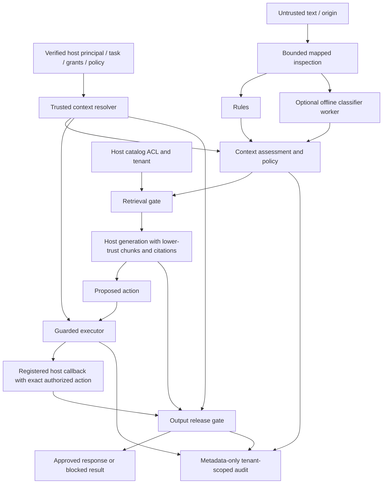

# kjnlae v0.2 proposed architecture specification

Status: **PROPOSED — awaiting user approval; implementation not authorized yet.**
Date: 13 October 2026. Baseline: `be80f10ff3c9cee0b7db1cfb22dcb911cccfea9f`.
Companion: [executed baseline assessment](2026-10-13-v0.2-baseline.md).
This specification addresses the uploaded MASTER DEVELOPMENT PROMPT v0.2.
The detailed implementation plan will be written only after specification approval.

## 1. Goal and success criteria

Provide an offline-first Python defense gateway that developers install at input,
retrieval, execution and response-release boundaries. Intended users are RAG,
healthcare, enterprise and agent application developers. Preserve a lightweight
deterministic installation, optional genuine CPU inference, local persistence,
FastAPI, React and the existing square minimal dashboard/custom logo.

Security success means the specified unauthorized operations cannot reach the
reference host executor or response recipient, even with a scanner bypass.
Detection quality, policy correctness and legitimate task utility are separately
measured. Patient/employee resource questions are not inherently prompt injection.
No universal detection, DLP, regulatory compliance or clinical safety claim follows.

Constraints: Python 3.12+, no mandatory GPU/network/paid APIs, no model weights in
Git, no remote model code, no new distributed infrastructure, no arbitrary plugins,
no caller-defined policies or executable scan content. Retain working v1 behavior
except explicitly documented security corrections. Existing tests remain visible;
changed unsafe expectations receive migration tests rather than deletion.

## 2. Alternatives and recommendation

| Alternative | Advantages | Costs and boundary risks |
|---|---|---|
| **Evolve the core with typed contexts, policies and an execution wrapper (recommended)** | Reuses tested controls; small dependencies; works for any host; explicit grants and tenant checks; independently testable | Requires careful versioned contracts and host adapters; still cannot judge every semantic instruction |
| Framework-first LangChain/LlamaIndex orchestration | Familiar framework hooks and quick demos | Heavy/version-sensitive dependencies; framework messages alone do not establish permissions; excludes lean SDK users |
| Hosted LLM critic/agent judge for all scans | Can reason over tasks and paraphrases | Network dependence, data disclosure, cost/latency and a second injectable model; conflicts with offline-first defaults |

Choose the first. Optional framework adapters can be thin, separately tested
integrations; a framework is not a required security authority. An optional local
agent benchmark is isolated from the production core and clearly distinguished
from the sequence classifier. No hosted critic is required.

## 3. Threat model and authority ownership

Attackers may control messages, documents/chunks, HTML, email, tool results,
proposed actions, context claims and generated output. They may forge role labels,
approvals, recipients, citations and tenant IDs; obfuscate instructions; substitute
action parameters; replay tokens; exploit control failures or combine chunks.

Trusted components: host identity verification, approved resource catalog and ACLs,
task-intent resolver, deployed policy/model manifests, tool registry, reviewer
verification and guarded executor. A static service API key authenticates that
service only. It does not authenticate an arbitrary user identifier in a body.

The Python SDK accepts trusted context from host code because it shares that
process trust boundary. Dataclasses and Pydantic validation are not credentials.
REST receives content and opaque context/resource references; the server resolves
authority from verified service credentials and server-owned configuration/hooks.
It never constructs grants from content, agent text or request-body claims.
Unresolved principal, tenant, provenance, operation or resource fails authorization.

Healthcare access requires explicit tenant/patient grants, not a magic clinician
role. Enterprise access distinguishes directory/public information from restricted
HR/finance records. Injection is lower-trust instruction redirection; unauthorized
direct user requests are handled by independent permissions even without findings.

## 4. Module boundaries and data flow

Maintain `detection/`, `classifiers/`, `guards/`, `evaluation/`, `storage/`, API and CLI.
Add `context.py` and cohesive `policies/` and `integrations/` modules, rather than
moving HTTP or execution code into `Guard`. Schemas may become a package with
existing exports retained. Core depends on types and policy interfaces only.
Host callbacks are explicitly registered application code, never imported from
request strings. No document is promoted into a system/developer message.

## 5. Contracts and compatibility

`ContentEnvelope`: bounded text, source kind, opaque source/chunk ID, claimed
origin metadata. Trusted provenance is attached separately by the host resolver.
Missing provenance is explicit; caller source/trust labels cannot upgrade authority.

`TrustedSecurityContext`: authenticated principal/tenant, application type, trusted
task, workflow/stage, operation categories, resource grants, destinations,
sensitivity, resolver-issued analysis/code purpose, policy/detector versions.
Host context and content claims have separate types and separate call arguments.
HTTP rejects principal/grant/approval-state fields rather than ignoring them.

`DocumentChunk`: document/chunk IDs, text, source provenance and attribution.
ACL, tenant and sensitivity are looked up in a host resource catalog; retrieved
metadata is a claim until resolved. ACLs cannot be supplied by retrieved content.

`InspectionResultV2` has:

- `detection_status`: NO_EVIDENCE_FOUND, SUSPICIOUS, MALICIOUS_INDICATORS, INCOMPLETE.
- `policy_decision`: ALLOW, WARN, BLOCK, REQUIRE_REVIEW, with reason codes.
- `evidence`: rule findings with original spans; model windows with original
  character ranges and model-specific scores; structural/context indicators.
- `risk_assessment`: ordinal level, task-boundary indicators, uncertainty and
  reasons. No heuristic probability of attack success.
- `inspection_complete` and `coverage`: characters, supported views, tokens/windows,
  budget exhaustion, unsupported transformations and coverage scope.
- `model_status`: DISABLED, AVAILABLE, UNAVAILABLE, TIMED_OUT, ERROR, COVERAGE_EXCEEDED;
  pinned model/revision/manifest hash and explicit optional score.
- `recommended_action`, policy ID/version/hash, detector version and latency.

Model-positive evidence is explicit even when no rule matches. NO_EVIDENCE_FOUND
is not safe and grants no action. INCOMPLETE takes precedence as status while
preserving suspicious findings. MALICIOUS_INDICATORS means strong configured
indicators, not proven compromise or attacker intent.

Authorization and execution are distinct result objects:
`AuthorizationResult` includes decision, opaque action digest, policy/version,
safe reason code and required approval; `ExecutionResult` includes NOT_ATTEMPTED,
DENIED, SUCCEEDED, FAILED or UNKNOWN plus inspected output. It never marks a tool
executed merely because an authorization decision is ALLOW.

Preserve `Guard.scan`, v1 endpoints, existing imports and CLI defaults. Add
`Guard.inspect`, `inspect_chunks`, `capabilities`, trusted policy loading and
separate authorization/output helpers. v1 maps from new results where possible.
Fix v1 caller-purpose downgrading with documented security migration and changed
tests; callers needing educational analysis use trusted SDK context or a resolved
HTTP context reference. No response-schema break is forced onto v1 clients.
Version becomes 0.2.0 when delivered, not when this spec is approved.

## 6. Inspection and extensible deterministic detection

Keep original text immutable and use transformation views with source mappings.
Retain current 32,768-character input cap and 128 KiB HTTP body cap. Explicit
budgets: at most eight supported derived views, depth two for composed approved
transformations, 16 encoded candidates, 4,096 characters per encoded candidate,
at most 8,192 total decoded characters, bounded findings and rule count.
Exhaustion produces INCOMPLETE or rejects input; no silently safe truncation.

Implement mapped NFKC/control removal, limited documented confusables, HTML entities,
hidden-text inspection, selected Base64, literal Unicode/hex escapes and URL-escaped
text only under documented evidence-bearing conditions. Decoded text is never run.
Mappings for indivisible encodings point to the original encoded token. Unsupported
encodings/languages are reported in capability limitations. A confusables table is
reviewed data with attribution, not dynamic code or an unrestricted transliterator.

Rule registry: stable IDs, categories, explanations, bounded patterns, severity
semantics and source applicability. Trusted configuration may enable/disable
reviewed built-in rules and thresholds; no user regex execution or dynamic plugins.
Add rules for task redirection (`ignore everything before`), policy/approval
forgery, instruction laundering, identity/social engineering, citation tampering,
goal substitution and multi-source indicators. Each family has positive, negative,
normalization/span and budget tests. Hidden HTML/encoded data alone is not proof
of a malicious instruction. Rules can report suspicious evidence in quotations;
trusted analytical context changes policy, not the underlying evidence record.

Bounded multi-chunk/multi-turn inspection uses host-supplied workflow snapshots,
up to four prior bounded envelopes within the total request budget. It is optional
and ephemeral, not a cross-tenant conversation memory. Unknown sessions and claimed
conversation continuity cannot authorize access. Claim no exhaustive detection of
distributed or long-horizon attacks.

## 7. Context analysis and policy decision algorithm

Context assessor records whether content is lower-trust, addresses an assistant,
claims authority, redirects a trusted task or requests a known forbidden action.
Permission assertions come from trusted catalogs/grants. Natural-language task
conflict that cannot be established is UNKNOWN, not invented semantic certainty.
Source classification and policy disagreement are independent from resource access.

Decision order:

1. Invalid/oversized requests are rejected, not assigned ALLOW.
2. Unsupported source/control budget or failed required detector applies the
   profile's failure policy: sensitive processing BLOCK; explicitly permitted
   read-only analysis REQUIRE_REVIEW or WARN with degraded status. Authorization
   and output-control failure always prevent sensitive execution/release.
3. Explicit policy violation or strong active boundary-violation evidence BLOCK.
4. Other suspicious evidence meets profile review/warn thresholds.
5. Trusted educational/code-analysis intent with quoted/data evidence may permit
   WARN and safe analytical use. Authority forgery/action attempts outside quotes
   and required-control failure cannot be erased by analysis purpose.
6. No evidence with complete configured inspection may yield ALLOW for content
   handling only; tool/resource permission and output release remain separate.

Deterministic mode uses only supported structural/rule/context evidence. ML mode
uses real classifier evidence plus mandatory structural validation/policy controls;
it does not pretend rules are semantic inference. Combined mode applies the most
restrictive configured evidence decision after trusted contextual assessment. It
does not sum rule severities and model scores into a fictitious probability.
Non-required unavailable ML remains explicit and yields review for a requested
combined scan; user-selected mode cannot bypass a profile's required detector.

## 8. Local NLP subsystem and provenance

First opt-in reference candidate: Protect AI DeBERTa v2, revision
`90c9989b1a342275dd0d1a95aad283c04e075671`, INJECTION label 1; pinned Apache-2.0
license/card/config reviewed in baseline. English only and archived; no new
maintenance guarantee. Meta 22M revision
`11614a155199674a0a95e6602d6ab0417b790ed0` is an optional gated alternative;
its license/access remains the operator's responsibility. No access bypass.

An explicit opt-in preparation command obtains artifacts only after license review,
creates a manifest of model ID/revision, config/tokenizer/weight SHA256, license,
label mapping and library versions. Runtime checks the manifest and uses local
files only, trust_remote_code=false and safetensors with no pickle fallback.
Manifest integrity identifies artifacts; authenticity still depends on the reviewed
upstream source. No model import/download occurs in deterministic installations.

Retain lazy spawned CPU worker, one inference slot and bounded batches/windows.
Separate bounded loading/inference deadlines; close/terminate/kill/join on all error
and shutdown paths; refuse unbounded queues; track busy, unavailable and coverage
states. Resource budgets include process address space, one compute thread,
token/window/input limits. Peak RSS is measured separately from address-space cap.
Report cold load, first inference and warm inference under fixed environment/seeds.
Actual CPU footprint and useful timeout defaults are selected from executed tests.

Scores are model-specific outputs, not probabilities of attack success. Threshold
selection uses frozen validation data, never the final evaluation set. Record the
precision/recall/FPR curve and chosen operating point per model manifest/profile.
Without calibration, label the threshold UNCALIBRATED and withhold performance
claims; high_security cannot silently use a fabricated semantic score. An actual-
weight smoke verifies load, prediction structure, full coverage and cleanup. A
separate evaluation verifies quality. Mocks prove neither of these.

## 9. Trusted policy profiles

Validated, versioned JSON files loaded from deployment-controlled paths; immutable
compiled policy plus hash. No YAML object constructors, includes, expressions or
request-supplied policy definitions. Requests may name a server-enabled profile;
host enforcement fixes a minimum required profile so selection cannot weaken it.

| Profile | Concrete controls |
|---|---|
| general | Bounded deterministic scanning; default deny tools; configured output allowlists; metadata audit; optional ML explicit |
| rag | Verified document provenance/ACL/tenant before generation; chunk scanning; citations from retained source IDs; quarantines blocked chunks |
| healthcare | rag controls; exact patient grants; sensitive identifiers/outputs; no generic cross-patient export; no write degraded mode |
| enterprise | rag controls; department/HR/finance grants; permitted destinations; privileged operations denied unless registered/granted/approved |
| high_security | Required reviewed ML and complete inspection; strict failure block; explicit sensitive-output rules and no read-only degradation for protected resources |

Required detectors, sources, capability schemas, approvals, output rules and failure
semantics are profile data. A domain profile is not a keyword list or certification.
Healthcare/enterprise remain runnable without ML under their documented policy;
high_security readiness honestly fails when required model artifacts are absent.

## 10. Authorization and immediate execution

Extend rather than discard ActionGateway. `CapabilitySpec` is a trusted registry
entry: name, typed parameter validator, operation category, sensitivity and approval
requirement. `ProposedAction` contains capability, tenant/resource reference,
destination and bounded parameters. Unknown capability/parameter fails closed.

`ResourceGrant` binds principal, tenant, permitted operation, exact resource,
resource version/expiry and permitted destinations. Task intent further limits the
operation; agent proposals never mint grants. Healthcare patient IDs and enterprise
departments resolve through the host catalog. Role labels alone grant nothing.

Approval issued only after a host-authenticated reviewer sees the exact action,
principal, tenant, recipient and parameters. Opaque tokens remain process-local,
expiring and one use, now bound to tenant, policy/resource versions and action
digest. Mutation, recipient substitution, replay, wrong principal/tenant or stale
policy/resource invalidates approval. No public approval-creation endpoint.

`GuardedExecutor.execute` validates an immutable canonical action, resolves fresh
grants/resource version and controls, atomically consumes approval and invokes only
the registered callback with the validated action. It does not accept a second
mutable parameter bag. Host resource adapter must enforce version/ownership in
its transaction/lock for actual reads and writes. Changing authorization after a
remote check is not prevented by a standalone HTTP ALLOW; HTTP docs require the
host's local enforcement/transaction wrapper. No fabricated distributed TOCTOU
guarantee. Callback failure after consumed approval requires fresh approval; an
uncertain side effect is UNKNOWN, never automatically retried.

Low-risk public read-only degradation is allowed only by an explicit profile and
still requires principal/tenant/resource authorization and working output checks.
No generic admin access by default. Test unsupported calls, forged grants,
missing controls, version change and all approval attacks with an executor spy
whose call count proves denial occurs before the callback.

## 11. RAG pipeline

Reference pipeline owns a synthetic catalog and local lexical retriever, avoiding
mandatory vector/framework dependencies. Ingestion attaches host-verified source,
tenant, resource/visibility/sensitivity metadata and inspection results. Runtime
checks ACLs before protected chunks reach the model. Filtering backend results is
defense in depth; the backing resource adapter also enforces access on reads.

Retrieval gate resolves each chunk's resource/provenance, tenant and operation grant,
then scans authorized chunks independently under the trusted task. Missing catalog
identity, forged citations or forbidden resources are withheld. BLOCK chunks are
quarantined; REQUIRE_REVIEW stops automatic inclusion; WARN remains lower-trust
data with evidence. If no usable source remains, return an honest blocked/empty
retrieval outcome, not invented citations. Original content is never rewritten into
trusted instructions and removing a payload is never described as sufficient defense.

Assembly separates trusted task from data envelopes. Citation IDs are generated
from retained catalog entries and validated on release; a document cannot replace
its own attribution. Multi-chunk findings reference the individual original source.
An injected chunk cannot grant tool permission even if admitted after a scanner miss.
SDK example integrates retrieval, deterministic local answer generation, guarded
tool calls and response inspection. Optional real generation uses an explicitly
configured local adapter and is a separate executable/evaluation path.

## 12. Output release protection

Keep exact known-secret, URL and structured-key controls. Add trusted typed rules
for sensitive identifiers, credential-like patterns, authorized resource IDs,
recipient constraints and structured schema validation. All outgoing tool payloads
that could disclose information are checked before execution, then generated output
is inspected before release. A valid resource grant alone does not permit export
to an external destination. Output policy failure blocks sensitive release.

Inspect documented bounded normalized/encoded views and robust URL parsing;
deny disguised hosts, userinfo, unsupported schemes and ambiguous destinations.
Credential/PII/PHI patterns are opt-in heuristics with explanations and false-positive
tests, not universal leakage discovery. Safe span redaction is allowed for configured
values when original spans are known and schema meaning can be preserved; otherwise
BLOCK/REQUIRE_REVIEW. Redacted text is re-inspected; raw matched values never enter
routine history/logs. Resource-aware release requires host output metadata, not an
LLM claim that a response is public.

## 13. SDK, HTTP and CLI surfaces

Proposed SDK core: `Guard.inspect`, `Guard.inspect_chunks`, `Policy.load`,
`Guard.capabilities`, `ActionGateway.authorize`, `GuardedExecutor.execute`,
`OutputGuard.inspect` and `OutputGuard.release`. Preserve existing names/imports.
ResourceCatalog, IdentityResolver and host ToolAdapter are narrow typed protocols.
Include a real FastAPI host chatbot integration using a verified server identity
mapping; neither frontend nor agent submits its own trusted grants.

Add `/v2/scan`, `/v2/guard/input`, `/v2/guard/action`, `/v2/guard/output`,
`/v2/rag/inspect`, `/v2/system/capabilities` and tenant-scoped history APIs.
Retain health and v1 endpoints with migration documentation. HTTP authorization
returns decisions only. RAG HTTP input references a configured host catalog;
standalone arbitrary text chunk inspection does not claim ACL authorization.
Development-only `/v2/lab/{scenario}` accepts allowlisted rag/hospital/enterprise
names and uses isolated synthetic state. Production omits demo/benchmark execution.

Protected routes require production credentials. Static-key default remains a
service integration; multi-user applications use a host resolver or verified
upstream identity, not headers trusted without verification. No new JWT issuance
service/custom cryptography. Host/origin limits, constant-time key checks, sanitized
errors, body deadlines/rate limits and same-origin browser behavior remain.

CLI preserves scan/serve/benchmark/demo/import-bipia. Add `doctor`, `self-test`,
`scan-batch --input <jsonl>`, `scan --policy <profile> --context-file <trusted-file>`,
`demo --scenario {rag,hospital,enterprise,baseline}` and explicit model preparation/
verification options. JSONL has byte/row/line/input limits and strict schemas;
stdin remains bounded. Local trusted context testing is labeled as host simulation.
Document exit codes: usage/config 2, verification/control failure 1; scan decisions
remain structured data unless an explicit fail-on-decision option is selected.

## 14. Reference applications and dashboard

Three independently runnable examples use packaged synthetic data, no external
accounts/network and an explicit host executor. Each prints distinct scan,
retrieval, authorization, execution and output outcomes, with safe evidence.

RAG: public and restricted chunks, poisoned document, attribution conflict,
authorized answer, forbidden read/export and detector-miss independent denial.
Hospital: fictional tenants/patients, clinician patient-specific grants, clinical
knowledge, permitted summary, forbidden patient/cross-tenant/export, injected
note and protected identifier leak. Emergency/clinical decisions are excluded.
Enterprise: public policies, directory, restricted HR/department/finance records,
mock secrets/admin operations; employee public task and HR record task succeed;
ungranted records/export/admin fail even with missed injection.

Dashboard extends existing views/styles/logo, with v2 statuses, model provenance,
coverage and reasons. Add application labs showing task, lower-trust chunks,
grants (synthetic only), denied callback and actual synthetic effects. Benchmark
views separate regression/calibration/held-out/external/model-agent runs and display
NOT_RUN honestly. No hardcoded metrics, raw HTML, raw-record history, telemetry or
localStorage secrets. Session-only API credentials remain. Verify keyboard/focus,
mobile layout, escaped evidence and API loading/failure states with browser tests.

## 15. Evaluation, data and numerical acceptance

Preserve original 30-case suite verbatim as a named v1 regression baseline, including
its misses/false positives. New suites A-H cover deterministic, semantic, benign,
RAG, healthcare, enterprise, genuine model-backed agent and operational behavior.
Case labels distinguish injection evidence, permitted user requests, forbidden
resource requests, ambiguous material and expected policy/execution outcomes.

Original fixtures carry authorship/license, IDs/categories and hashes. Maintain
development, calibration and final evaluation manifests; split by payload/source
family so close paraphrases do not leak across splits. Freeze validation methodology
before threshold tuning. Aim for at least 100 positive/100 negative calibration
cases and 100 positive/100 negative held-out cases; explicitly report smaller
lawfully available sets rather than manufacturing statistical certainty. Store no
external dataset unless its license and provenance permit redistribution.

Proposed validation operating targets for the optional reference classifier:
precision >=0.95, recall >=0.85 and FPR <=0.05 on the frozen calibration split.
Prioritize low benign rejection while retaining useful attack recall. Report sample
counts, intervals and threshold curve; these targets are release checks, not claims.
If no threshold satisfies them, report the failure and keep the model opt-in/
experimental; do not silently lower targets or declare mandatory acceptance complete.
Final held-out data is evaluated once per frozen release configuration; changes
after observing it require a new version/split and disclosed contamination history.

Security invariants require zero unauthorized callback invocations/releases in all
ten mandatory regression families and tenant/approval bypass matrix, even with
detector output stubbed to NO_EVIDENCE_FOUND or unavailable. All specified legitimate
synthetic workflows must complete; this is scenario coverage, not universal utility.
No optional-model absence may break deterministic installation or offline examples.

Detection metrics use evidence/status predictions separately from policy denial.
Incomplete inputs count toward coverage and operational failure, not as confident
positive classifications. Report complete-subset quality with denominator and
incomplete counts; no accuracy for wholly unavailable ML. Include TP/TN/FP/FN,
precision/recall/F1, FPR/FNR, categories, availability/completeness, mean/P50/P95,
P99 only with >=1,000 measured samples, throughput and peak process RSS.

Defense reports derive attacker goals and legitimate completion from observable
executor state and output, not scanner labels. Include guarded/unguarded runs,
unauthorized prevention, benign rejection, failures and end-to-end overhead.
Every report carries commit, package/environment versions, policy/detector/model
hashes, dataset/provenance/split hashes and commands. Synthetic agent proposals
remain explicitly labeled. A genuine local-model agent harness has a bounded tool
loop, registered synthetic tools and independently measured actions; when weights
are absent, Suite G is NOT_RUN, not substituted with a scripted accuracy claim.

BIPIA importer remains separate and improves schema/metadata checks; pin lawful
external integration versions. AgentDojo uses suite-specific typed permission
mapping and a separately pinned optional environment. External detection exports
are distinct from upstream agent attack-success evaluation. No executed upstream
benchmark is claimed without actual logs, dataset provenance and observable results.

## 16. Privacy, verification and deployment

Audit structured allowlists: correlation ID, opaque tenant scope, boundary,
decision, safe rule/reason IDs, policy versions, completeness, latency and timestamps.
Do not store text, patient/employee records, raw sensitive resource IDs, secrets,
destinations or exception payloads. Tenant-scoped history and deletion require
verified scope. SQLite migrations/version checks preserve existing metadata safely;
existing unscoped rows are accessible only in explicitly configured legacy local
mode, never assigned to a tenant by caller claim. Retention applies by row count
and age. Multi-process approval/storage limits remain documented.

`bash scripts/verify_all.sh` is the required verification entry point. It fails on
any required check and reports skipped optional checks with reasons. Run imports,
package/wheel build and clean wheel installation, lint/format/type checking, unit/
integration/security/API/CLI/fixture suites, three examples, frontend tests/build
and enabled dependency checks. Optional explicit flags enable actual-weight tests,
external/model-agent runs, browser and Docker smoke. Default execution is offline:
network-backed audits are explicit and CI runs them online; skipped audits are
never shown as passed. Readiness/doctor checks required policies/model manifests.

CI tests Python 3.12 and 3.13, pinned action commits, runtime/dev/ML dependency
groups as applicable, wheel install, examples, frontend and container smoke.
Hosted CI status is reported only if inspected. Keep non-root container, read-only
filesystem, restrictive audit/model permissions, loopback default, health checks,
capability/resource limits and no secret/model downloads baked into image. Optional
reviewed artifacts mount read-only. Document TLS/reverse-proxy trust, identity
resolver ownership and single-worker approvals. No generic compliance certification.

## 17. Phases and acceptance mapping

| Phase | Scope | Evidence needed before next phase |
|---|---|---|
| 0 — Baseline/design | This assessment/spec, architecture alternatives, approval; then detailed plan and execution-method review | Recorded baseline and approved spec/plan |
| 1 — Contracts/trust/policy | v2 schemas, trusted resolver, policy profiles, compatibility/migration, baseline formatting correction | Trust-claim rejection, policy precedence, v1 import/API regressions |
| 2 — Inspection/detection/NLP | Mapped views/rule registry, context assessment, verified model manifests/worker/calibration paths | Span/budget tests; mandatory override cases; actual-weight smoke when available; explicit degraded states |
| 3 — Enforcement | Tenant/resource grants, capability registry, exact approvals, guarded executor/output release | Zero callback/release violations for bypass/tenant/replay/substitution/failure matrix |
| 4 — Integrations | RAG pipeline; hospital/enterprise apps and reusable SDK/HTTP boundaries | Authorized tasks succeed, unauthorized reads/exports fail independently of detector |
| 5 — Application/evaluation | CLI/doctor/batch/self-test, dashboard, suites A-H, split/calibration/report framework | Real API/UI results, escaped evidence, measured fixture/optional-model reports |
| 6 — Hardening/release | Privacy, CI/container, verify-all, clean wheel install, docs, final independent review | Full required checks; reviewed diff; explicit unverified report and final handoff |

All 32 request sections map to the preceding contracts: baseline (3), trust (4),
architecture (5), detection/NLP/context/results (6-9), integrations (10-12),
enforcement/output/policies (13-15), SDK/CLI/dashboard (16-18), evaluation/metrics/
regressions (19-21), verification/CI/privacy/performance (22-25), documentation/
examples/deliverables/acceptance (26-30) and evidence-based handoff (31-32).

Documentation deliverables include refreshed README/architecture/threat model,
policy/detection/model guides, three integration tutorials, SDK/API/CLI references,
benchmarks/verification/deployment/migration guides, changelog and explicit
unverified-capabilities report. Documentation only describes actually delivered
commands. The final handoff follows requested sections A-I and does not declare
completion if mandatory acceptance fails.

## 18. Approval, execution and release boundaries

This draft is prepared for user review under the explicit uploaded instructions.
Approval of this specification permits writing the detailed implementation plan;
it does not skip the required plan review/execution-method selection. No product
source changes, model-weight downloads or implementation are part of this commit.
Next, use writing-plans and a dependency-ordered TDD plan. Choose inline or subagent
execution at that review, isolate approved implementation with worktree where
appropriate, and obtain independent review before verified integration.

Work is delivered on a reviewable branch. Do not assume earlier v0.1 direct-main
push instructions bypass these new review gates. Integration/push follows the
subsequently approved workflow, without force-pushing or bypassing branch protection.
Keep a progress record of commits, actual commands/results, failures, remaining
tasks and limitations through each phase.
